<div align="center">

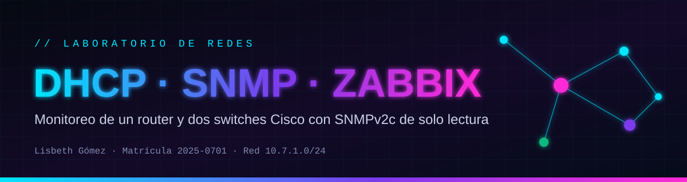

<br>


**Lisbeth Gómez** · Matrícula **2025-0701** · Red `10.7.1.0/24`

</div>

---

## 🎬 Video demostrativo

<div align="center">
  <a href="https://youtu.be/ZxOJ3XAqfVo" target="_blank">
    
  </a>
  <br>
  <p style="font-family: 'Courier New', monospace; color: #888; font-size: 14px;">
    <b>DHCP · SNMP de solo lectura · Zabbix</b>
  </p>
</div>


---

## 📑 Índice

1. [Propósito y objetivos](#-propósito-y-objetivos)
2. [Entorno del laboratorio](#-entorno-del-laboratorio)
3. [Topología](#-topología)
4. [Plan de direccionamiento](#-plan-de-direccionamiento)
5. [Direccionamiento IP del router y los switches](#-direccionamiento-ip-del-router-y-los-switches)
6. [Servidor DHCP para la LAN](#-servidor-dhcp-para-la-lan)
7. [Comunidad SNMP de solo lectura](#-comunidad-snmp-de-solo-lectura)
8. [Zabbix: instalación](#-zabbix-instalación)
9. [Zabbix como cliente DHCP](#-zabbix-como-cliente-dhcp)
10. [Agregar el router y los switches a Zabbix](#-agregar-el-router-y-los-switches-a-zabbix)
11. [Verificación de datos SNMP en Zabbix](#-verificación-de-datos-snmp-en-zabbix)
12. [Resultado frente a los requisitos](#-resultado-frente-a-los-requisitos)
13. [Scripts](#-scripts)
14. [Running-configs](#-running-configs)
15. [Problemas encontrados](#-problemas-encontrados)
16. [Estructura del repositorio](#-estructura-del-repositorio)

---

## 🎯 Propósito y objetivos

El propósito de esta práctica es implementar y validar la comunicación y monitorización de dispositivos de red utilizando protocolos estándar como DHCP y SNMP, integrando un sistema de monitorización centralizado.

El laboratorio demuestra que:

- El router **R1** es el gateway y el **servidor DHCP** de la LAN `10.7.1.0/24`;
- **R1**, **SW1** y **SW2** permiten **leer** su información por SNMP pero **no modificarla**;
- El servidor **Ubuntu** obtiene su dirección como **cliente DHCP** y ejecuta Zabbix;
- Zabbix recibe los datos SNMP de los tres equipos: sistema, interfaces y tráfico.

| # | Objetivo | Estado |
|:-:|---|:-:|
| 1 | Direccionamiento IP en router y switches | ✅ |
| 2 | Servidor DHCP para la red LAN | ✅ |
| 3 | Comunidad SNMP de solo lectura | ✅ |
| 4 | Servidor Zabbix como cliente DHCP | ✅ |
| 5 | Verificar en Zabbix los datos SNMP del router y los switches | ✅ |
| 6 | Documentación con imágenes, diagramas, scripts y running-configs | ✅ |
| 7 | Video demostrativo al inicio del repositorio | ✅ |

Detalle ampliado: [`docs/01-proposito-y-objetivos.md`](docs/01-proposito-y-objetivos.md).

---

## 🧱 Entorno del laboratorio

| Componente | Detalle |
|---|---|
| Simulador | GNS3 2.2.61 con máquinas virtuales de VMware |
| **R1** | Cisco 2691 · IOS 12.4(25d) |
| **SW1** · **SW2** | Cisco vIOS-L2 · IOS 15.2 |
| **Servidor Zabbix** | Ubuntu Server 24.04 LTS · Zabbix 7.0.32 · Apache · MySQL 8.0 |
| **PC de gestión** | Windows 10 · navegador para la interfaz web |

---

## 🧭 Topología

### Diagrama

<div align="center">
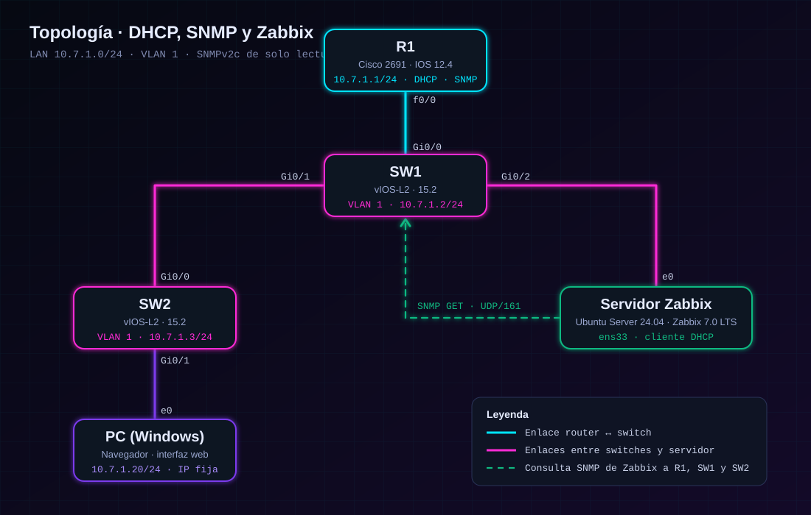
</div>

### Captura de GNS3

[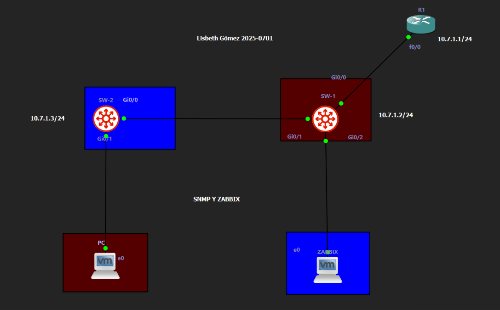](screenshots/01-topologia/gns3-topologia.png)

**Qué demuestra:** `R1 — SW1`, con el servidor Zabbix conectado a SW1 y la cadena `SW1 — SW2 — PC`. Todos los enlaces aparecen en verde y se ven los nombres de puerto y las direcciones de los equipos Cisco.

### Diagrama lógico

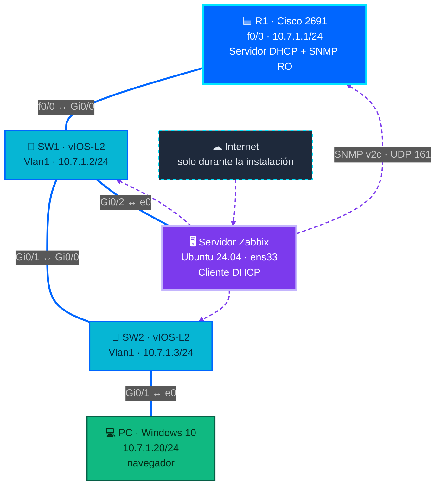

> Las líneas **continuas azules** son enlaces de la red; las **punteadas moradas** son conexión temporal a internet (instalación) y consultas SNMP.

---

## 🧮 Plan de direccionamiento

El esquema parte de la matrícula **2025-0701**: la red `10.7.1.0/24` usa los dígitos **7** y **1** de `0701` como segundo y tercer octeto.

| Equipo | Interfaz | Dirección | Asignación |
|---|---|---|:-:|
| **R1** | f0/0 | `10.7.1.1/24` | 🔵 Estática |
| **SW1** | Vlan1 | `10.7.1.2/24` | 🔵 Estática |
| **SW2** | Vlan1 | `10.7.1.3/24` | 🔵 Estática |
| **Servidor Zabbix** | ens33 | Pool DHCP (`10.7.1.11` en adelante) | 🟣 Dinámica |
| **PC de gestión** | Ethernet0 | `10.7.1.20/24` | 🔵 Estática |

Detalle y criterio de diseño: [`docs/02-plan-de-direccionamiento.md`](docs/02-plan-de-direccionamiento.md).

---

## 🌐 Direccionamiento IP del router y los switches

**Configuración en R1:**

```
interface FastEthernet0/0
 ip address 10.7.1.1 255.255.255.0
 no shutdown
```

**Configuración en los switches** (SW1 se muestra; SW2 usa `10.7.1.3`):

```
interface Vlan1
 ip address 10.7.1.2 255.255.255.0
 no shutdown
!
ip default-gateway 10.7.1.1
```

### Evidencias

<table>
<tr>
<td align="center" valign="top" width="33%"><b>R1 · <code>show ip interface brief</code></b><br>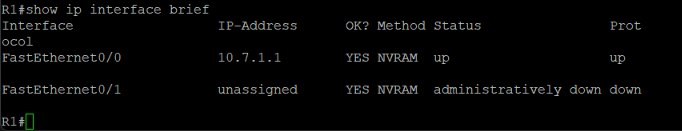<br><sub>Fa0/0 = <code>10.7.1.1</code> (<i>up/up</i>, origen NVRAM). Fa0/1 sin usar.</sub></td>
<td align="center" valign="top" width="33%"><b>SW1 · <code>show ip interface brief</code></b><br>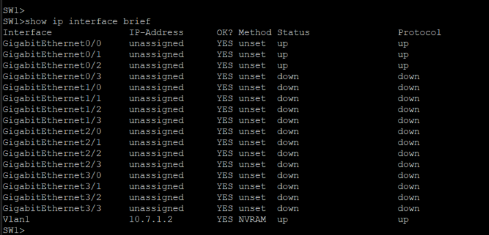<br><sub>Vlan1 = <code>10.7.1.2</code> (<i>up/up</i>). Tres puertos activos: Gi0/0, Gi0/1 y Gi0/2.</sub></td>
<td align="center" valign="top" width="33%"><b>SW2 · <code>show ip interface brief</code></b><br>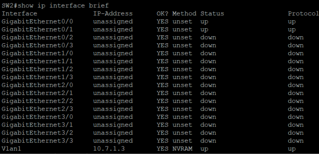<br><sub>Vlan1 = <code>10.7.1.3</code> (<i>up/up</i>). Dos puertos activos: Gi0/0 y Gi0/1.</sub></td>
</tr>
</table>

<table>
<tr>
<td align="center" valign="top" width="50%"><b>R1 · pings a la LAN</b><br>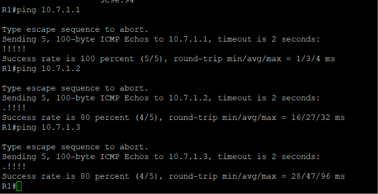<br><sub>R1 → <code>10.7.1.1</code> (propia) 100 %, <code>.2</code> 80 % y <code>.3</code> 80 %. El primer paquete se pierde mientras se resuelve la dirección MAC; el resto responde.</sub></td>
<td align="center" valign="top" width="50%"><b>Servidor Zabbix → R1, SW1 y SW2</b><br>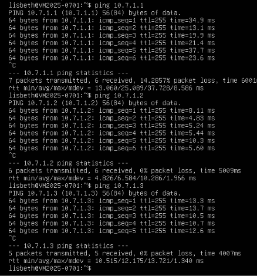<br><sub>Respuestas de <code>10.7.1.1</code>, <code>.2</code> y <code>.3</code>, con tiempos de 5 a 38 ms.</sub></td>
</tr>
</table>

**PC de gestión:** dirección fija `10.7.1.20/24` con gateway `10.7.1.1`.

[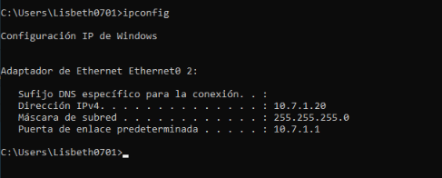](screenshots/02-direccionamiento-ip/pc-ipconfig.png)

---

## 📬 Servidor DHCP para la LAN

R1 entrega direcciones en la LAN con el pool **`LAN`**.

```
ip dhcp excluded-address 10.7.1.1 10.7.1.10
!
ip dhcp pool LAN
 network 10.7.1.0 255.255.255.0
 default-router 10.7.1.1
 dns-server 8.8.8.8
```

| Parámetro | Valor |
|---|---|
| Red | `10.7.1.0/24` |
| Excluidas | `10.7.1.1` a `10.7.1.10` (equipos de red) |
| Rango asignable | `10.7.1.11` a `10.7.1.254` |
| Gateway / DNS | `10.7.1.1` / `8.8.8.8` |

### Proceso DHCP (DORA)

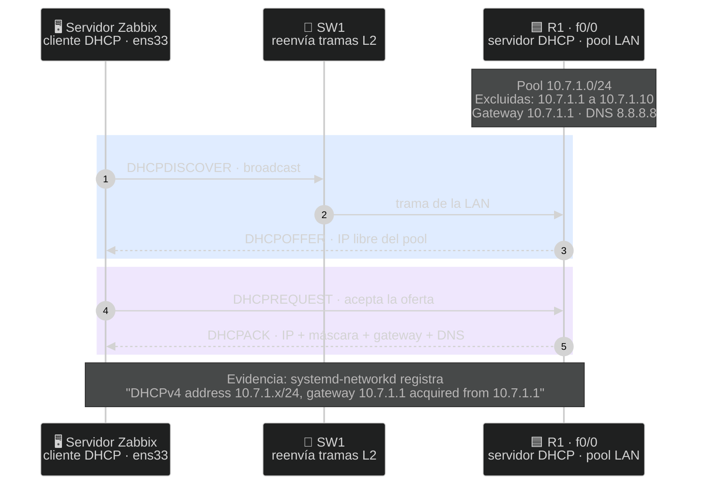

### Evidencias

<table>
<tr>
<td align="center" valign="top" width="50%"><b>Pool DHCP en el running-config</b><br>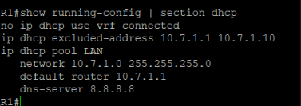<br><sub>Dirección excluida <code>10.7.1.1 – 10.7.1.10</code> y pool <code>LAN</code> con red, gateway y DNS.</sub></td>
<td align="center" valign="top" width="50%"><b>Concesiones, conflictos y pool</b><br>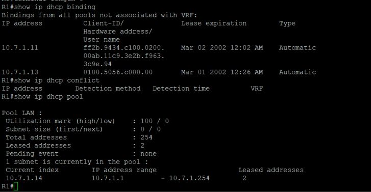<br><sub><code>show ip dhcp binding</code>, <code>show ip dhcp conflict</code> y <code>show ip dhcp pool</code>.</sub></td>
</tr>
</table>

**Qué demuestra** (captura de estado final):

- R1 concedió `10.7.1.11` al servidor (tipo *Automatic*). Su Client-ID coincide con el DUID que informa el servidor en `networkctl` (`…ab11c93e2bf9633c9e94`).
- `show ip dhcp conflict` aparece **vacío**: no hay direcciones en conflicto.
- El pool `LAN` tiene 254 direcciones, **2 concedidas** y la subred activa `10.7.1.1 – 10.7.1.254`.
- La segunda concesión (`10.7.1.13`, Client-ID `0100.5056.c000.00`) pertenece a otro cliente de VMware que pidió dirección en la LAN; no forma parte de la topología.

---

## 🔍 Comunidad SNMP de solo lectura

```
snmp-server community ZBX_RO RO
snmp-server location Laboratorio
```

> `RO` = *read-only*: la comunidad permite **consultar** pero no **modificar**. `ZBX_RO` es un valor de laboratorio.

<table>
<tr>
<td align="center" valign="top" width="33%"><b>R1</b><br>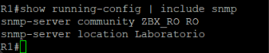</td>
<td align="center" valign="top" width="33%"><b>SW1</b><br>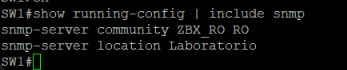</td>
<td align="center" valign="top" width="33%"><b>SW2</b><br>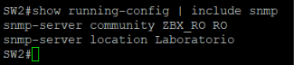</td>
</tr>
</table>

### Pruebas desde el servidor

Se consulta `sysName` (`1.3.6.1.2.1.1.5.0`) y se intenta modificar `sysLocation` (`1.3.6.1.2.1.1.6.0`).

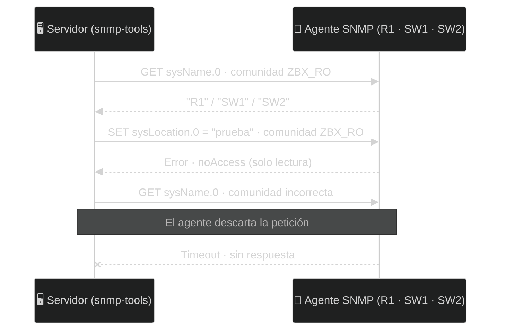

| Prueba | Resultado esperado | R1 | SW1 | SW2 |
|---|---|:-:|:-:|:-:|
| ✅ Lectura con `ZBX_RO` | Devuelve el nombre del equipo | [captura](screenshots/04-snmp-solo-lectura/snmpget-r1.png) | [captura](screenshots/04-snmp-solo-lectura/snmpget-sw1.png) | [captura](screenshots/04-snmp-solo-lectura/snmpget-sw2.png) |
| ⛔ Escritura con `ZBX_RO` | `Reason: noAccess` | [captura](screenshots/04-snmp-solo-lectura/snmpset-denegado-r1.png) | [captura](screenshots/04-snmp-solo-lectura/snmpset-denegado-sw1.png) | [captura](screenshots/04-snmp-solo-lectura/snmpset-denegado-sw2.png) |
| 🚫 Comunidad incorrecta | `Timeout: No Response` | [captura](screenshots/04-snmp-solo-lectura/comunidad-incorrecta-r1.png) | [captura](screenshots/04-snmp-solo-lectura/comunidad-incorrecta-sw1.png) | [captura](screenshots/04-snmp-solo-lectura/comunidad-incorrecta-sw2.png) |

<table>
<tr>
<td align="center" valign="top" width="50%"><b>✅ Lectura · <code>snmpget</code> a R1</b><br>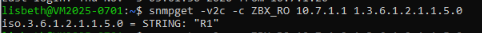<br><sub>R1 responde con su nombre (<code>"R1"</code>).</sub></td>
<td align="center" valign="top" width="50%"><b>⛔ Escritura · <code>snmpset</code> a R1</b><br>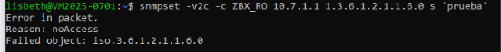<br><sub>R1 rechaza la escritura de <code>sysLocation</code> con <b>noAccess</b>. Lo mismo ocurre en SW1 y SW2.</sub></td>
</tr>
</table>

**El valor no cambió:** tras los intentos de escritura, `sysLocation` sigue siendo `"Laboratorio"`.

[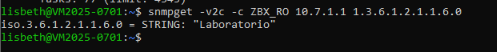](screenshots/04-snmp-solo-lectura/syslocation-sin-cambios.png)

---

## 🧩 Zabbix: instalación

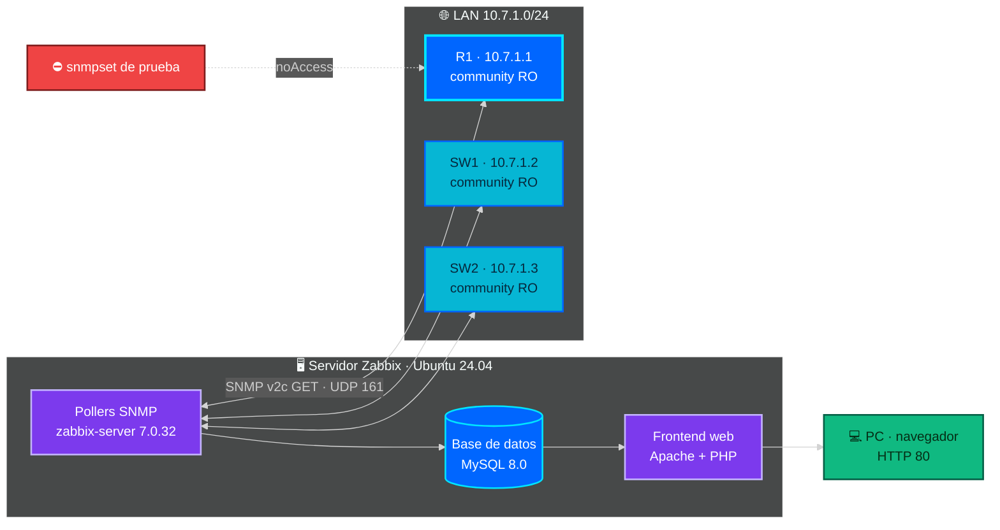

Scripts: [`01_instalar_zabbix.sh`](scripts/01_instalar_zabbix.sh) y [`02_configurar_bd_zabbix.sh`](scripts/02_configurar_bd_zabbix.sh). Procedimiento: [`docs/03-procedimiento-zabbix.md`](docs/03-procedimiento-zabbix.md).

> Para descargar los paquetes, el servidor usó **temporalmente** un segundo adaptador con salida a internet. Con Zabbix instalado se retiró y quedó solo la LAN.

### Asistente web

<table>
<tr>
<td align="center" valign="top" width="33%"><b>1 · Bienvenida</b><br>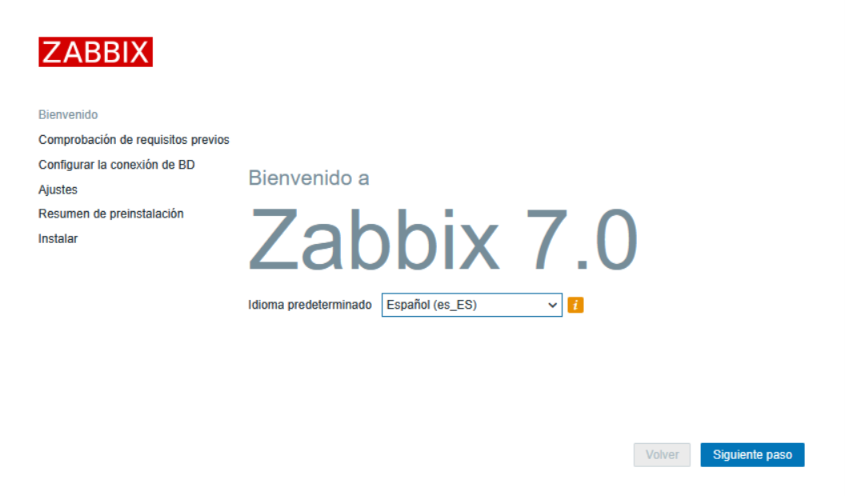</td>
<td align="center" valign="top" width="33%"><b>2 · Conexión de BD</b><br>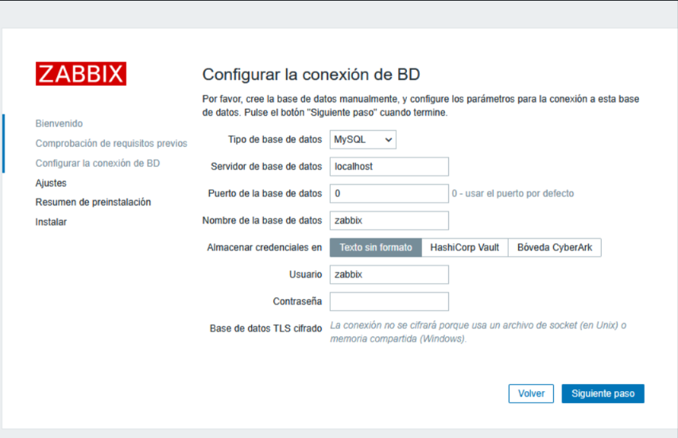</td>
<td align="center" valign="top" width="33%"><b>3 · Ajustes</b><br>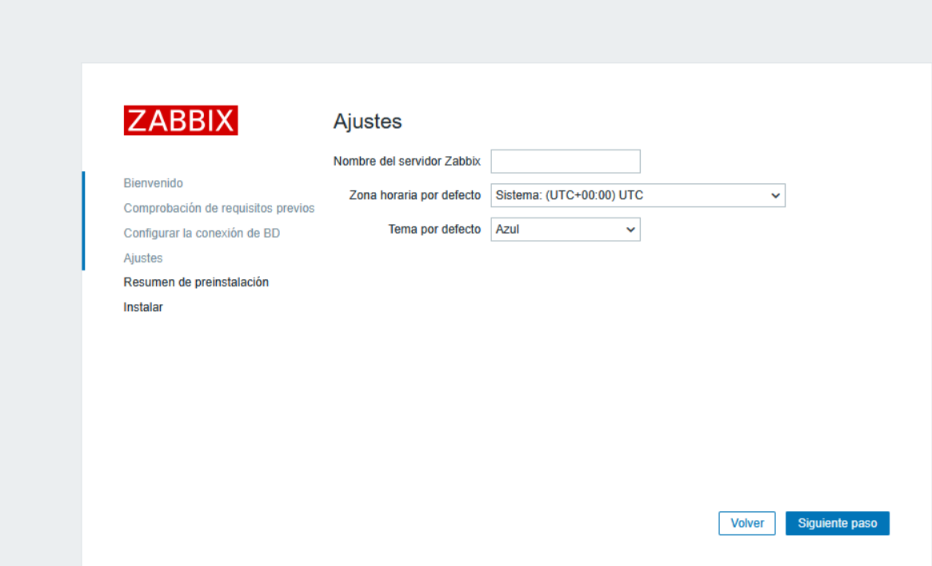</td>
</tr>
</table>

Pantalla inicial de **Zabbix 7.0** en español. Base de datos MySQL, servidor `localhost`, base `zabbix` y usuario `zabbix`. El último paso permite fijar el nombre del servidor, la zona horaria y el tema.

### Servicio y dashboard

<table>
<tr>
<td align="center" valign="top" width="50%"><b><code>systemctl status zabbix-server</code></b><br>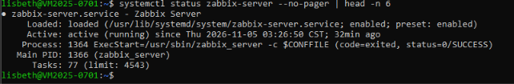<br><sub>Servicio <b>active (running)</b> y <i>enabled</i>.</sub></td>
<td align="center" valign="top" width="50%"><b>Dashboard</b><br>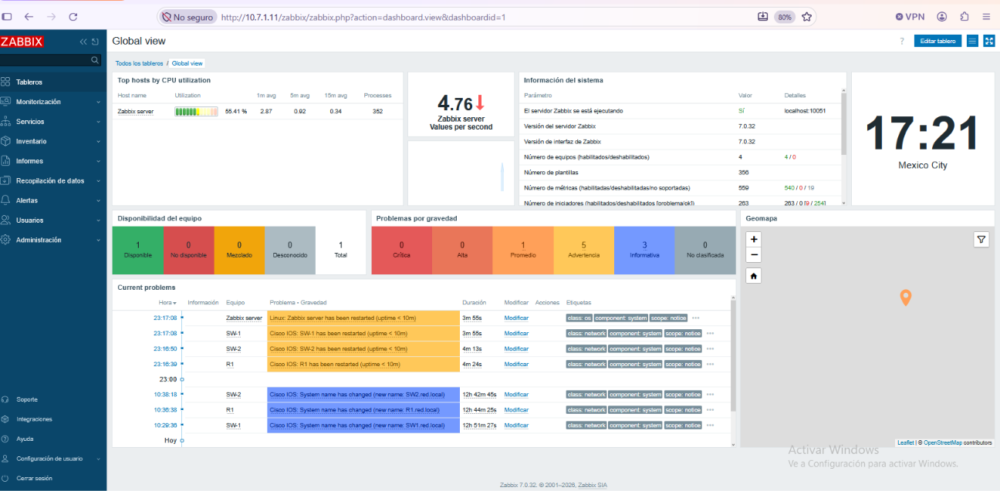<br><sub>"El servidor Zabbix se está ejecutando: Sí" · versión <b>7.0.32</b> · <b>4 equipos</b> habilitados.</sub></td>
</tr>
</table>

---

## 🖧 Zabbix como cliente DHCP

El servidor obtiene su IP de R1 por DHCP. Archivo `/etc/netplan/50-cloud-init.yaml`:

```yaml
network:
  version: 2
  ethernets:
    ens33:
      dhcp4: true
```

<table>
<tr>
<td align="center" valign="top" width="50%"><b><code>ip -4 addr show ens33</code></b><br>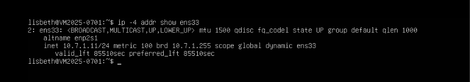</td>
<td align="center" valign="top" width="50%"><b><code>journalctl</code> · historial DHCPv4</b><br>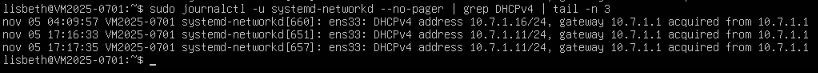</td>
</tr>
</table>

[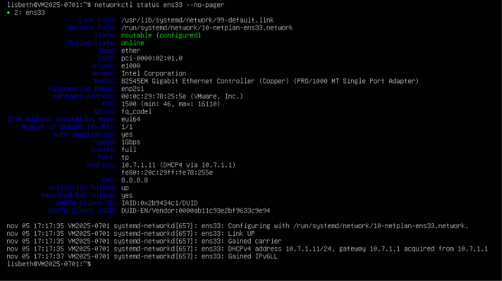](screenshots/06-zabbix-cliente-dhcp/ens33-networkctl-status.png)

**Qué demuestra:**

| Evidencia | Valor observado |
|---|---|
| `ip -4 addr show ens33` | `10.7.1.11/24` · *scope global **dynamic*** |
| `networkctl status ens33` | *Address* `10.7.1.11 (DHCP4 via 10.7.1.1)` · *DNS* `8.8.8.8` · *State* `routable (configured)` · *Online state* `online` |
| Archivo de red | `/run/systemd/network/10-netplan-ens33.network`, generado por netplan |
| Registro de `systemd-networkd` | `DHCPv4 address 10.7.1.11/24, gateway 10.7.1.1 acquired from 10.7.1.1` |
| R1 (`show ip dhcp binding`) | `10.7.1.11` concedida al servidor (ver [sección DHCP](#-servidor-dhcp-para-la-lan)) |

Script: [`03_configurar_cliente_dhcp.sh`](scripts/03_configurar_cliente_dhcp.sh) · Evidencias: [`05_evidencias_cliente_dhcp.sh`](scripts/05_evidencias_cliente_dhcp.sh).

> ℹ️ La dirección del servidor la administra R1 y puede cambiar: el historial muestra `10.7.1.16` y luego `10.7.1.11`. Por eso algunas capturas de Zabbix aparecen con `10.7.1.16` en la barra de direcciones y otras con `10.7.1.11`. Es el comportamiento esperado de un cliente DHCP.

---

## ➕ Agregar el router y los switches a Zabbix

Ruta: **Recopilación de datos → Equipos → Crear equipo**.

| Campo | R1 | SW1 | SW2 |
|---|---|---|---|
| Nombre del equipo | `R1` | `SW-1` | `SW-2` |
| Plantilla | Cisco IOS by SNMP | Cisco IOS by SNMP | Cisco IOS by SNMP |
| Grupo de equipos | Network devices | Network devices | Network devices |
| Interfaz SNMP | `10.7.1.1` : `161` | `10.7.1.2` : `161` | `10.7.1.3` : `161` |
| Versión SNMP | SNMPv2 | SNMPv2 | SNMPv2 |
| Comunidad SNMP | `{$SNMP_COMMUNITY}` | `{$SNMP_COMMUNITY}` | `{$SNMP_COMMUNITY}` |
| Macro `{$SNMP_COMMUNITY}` | `ZBX_RO` | `ZBX_RO` | `ZBX_RO` |

<table>
<tr>
<td align="center" valign="top" width="50%"><b>Formulario del equipo R1</b><br>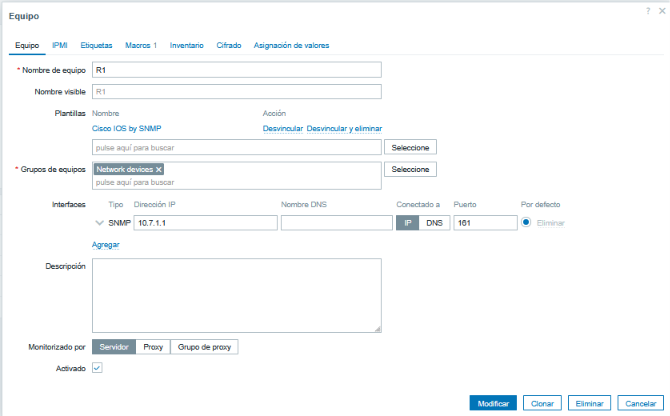<br><sub>Nombre <code>R1</code>, plantilla <i>Cisco IOS by SNMP</i>, grupo <i>Network devices</i> e interfaz SNMP <code>10.7.1.1:161</code>.</sub></td>
<td align="center" valign="top" width="50%"><b>Pestaña Macros</b><br>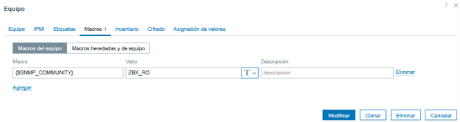<br><sub>Macro <code>{$SNMP_COMMUNITY}</code> = <code>ZBX_RO</code>, igual a la comunidad configurada en el equipo.</sub></td>
</tr>
</table>

**Lista de equipos en Zabbix**

[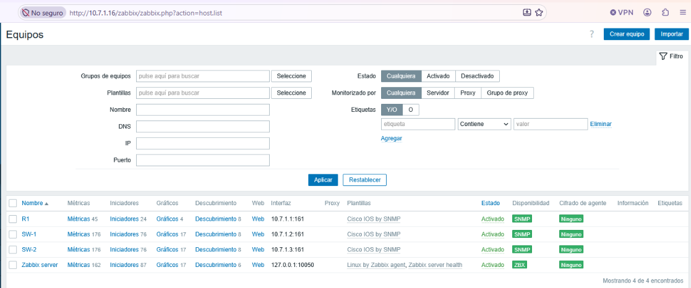](screenshots/07-zabbix-agregar-equipos/lista-equipos-snmp-verde.png)

| Equipo | Interfaz | Plantilla | Disponibilidad |
|---|---|---|:-:|
| R1 | `10.7.1.1:161` | Cisco IOS by SNMP | 🟩 **SNMP** |
| SW-1 | `10.7.1.2:161` | Cisco IOS by SNMP | 🟩 **SNMP** |
| SW-2 | `10.7.1.3:161` | Cisco IOS by SNMP | 🟩 **SNMP** |
| Zabbix server | `127.0.0.1:10050` | Linux by Zabbix agent · Zabbix server health | 🟩 **ZBX** |

---

## ✅ Verificación de datos SNMP en Zabbix

Ruta: **Monitorización → Datos más recientes**, filtrando por **Equipos**.

### Datos básicos del sistema (filtro `System`)

<table>
<tr>
<td align="center" valign="top" width="33%"><b>R1</b><br>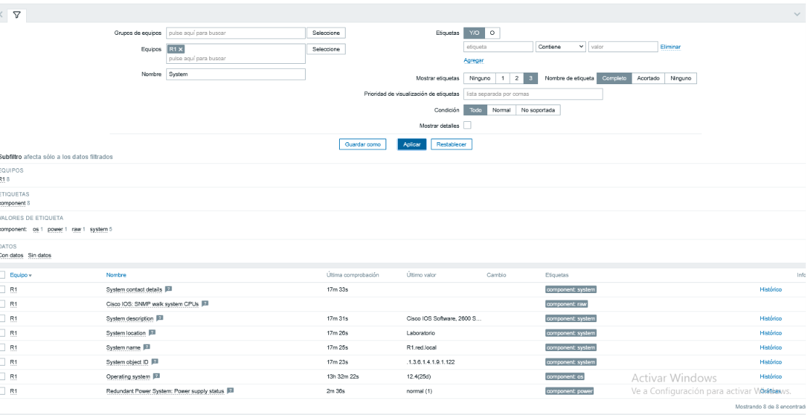</td>
<td align="center" valign="top" width="33%"><b>SW-1</b><br>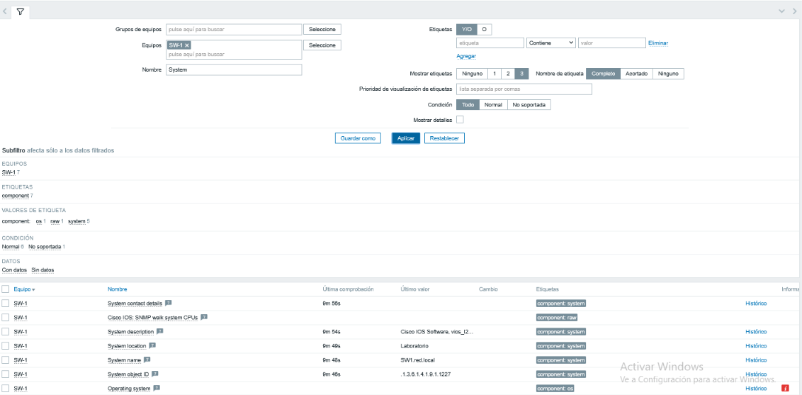</td>
<td align="center" valign="top" width="33%"><b>SW-2</b><br>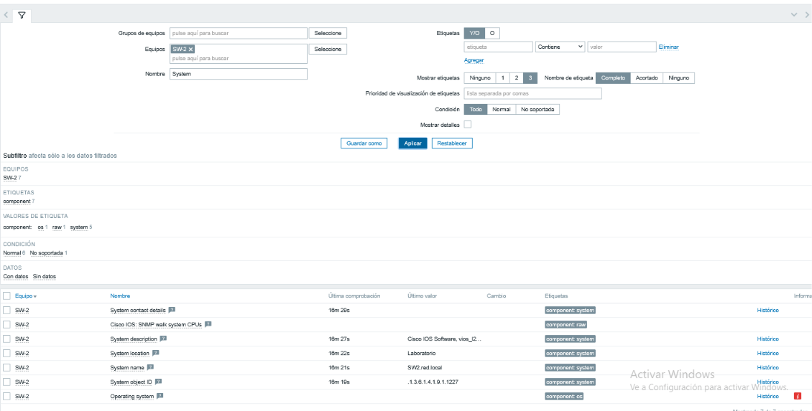</td>
</tr>
</table>

| Elemento en Zabbix | R1 | SW-1 | SW-2 |
|---|---|---|---|
| System name | `R1.red.local` | `SW1.red.local` | `SW2.red.local` |
| System location | `Laboratorio` | `Laboratorio` | `Laboratorio` |
| System contact details | *(vacío)* | *(vacío)* | *(vacío)* |
| System object ID | `.1.3.6.1.4.1.9.1.122` | `.1.3.6.1.4.1.9.1.1227` | `.1.3.6.1.4.1.9.1.1227` |
| System description | Cisco IOS Software, 2600… | Cisco IOS Software, vios_l2… | Cisco IOS Software, vios_l2… |
| Operating system | `12.4(25d)` | sin valor | sin valor |
| Power supply status | `normal (1)` | — | — |

**Coincidencia con la terminal:** `System location` = `Laboratorio` es el valor configurado en los equipos y el mismo que devuelve `snmpget`. El nombre aparece con el dominio (`R1.red.local`) porque los equipos tienen `ip domain-name red.local`; ver [problemas encontrados](#-problemas-encontrados).

### Todos los elementos recolectados

<table>
<tr>
<td align="center" valign="top" width="33%"><b>R1</b><br>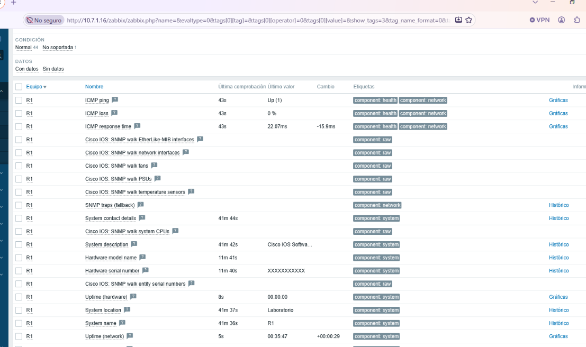</td>
<td align="center" valign="top" width="33%"><b>SW-1</b><br>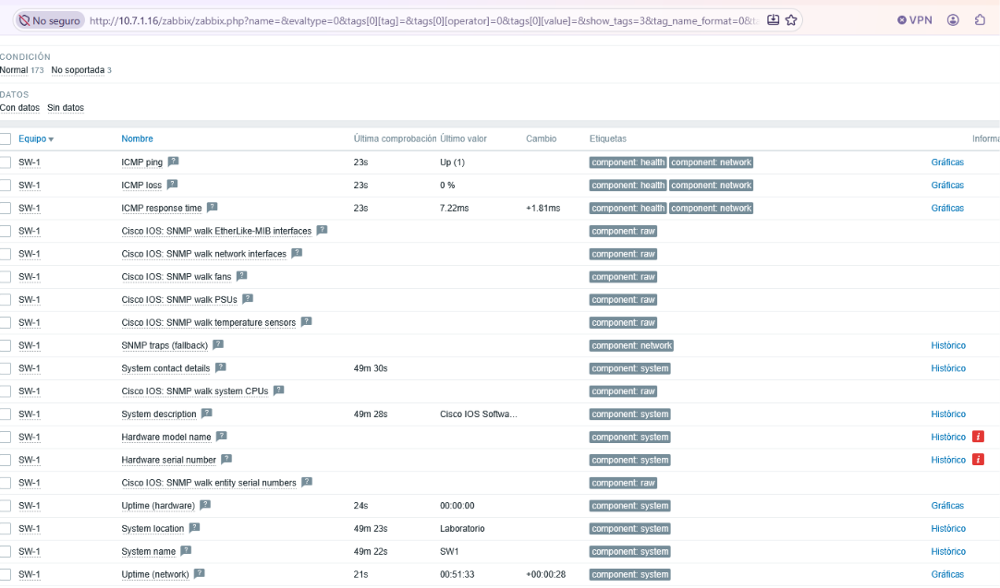</td>
<td align="center" valign="top" width="33%"><b>SW-2</b><br>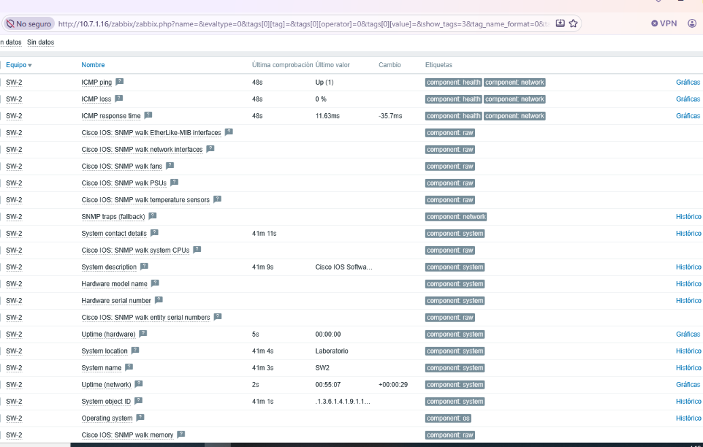</td>
</tr>
</table>

Se reciben, entre otros: respuesta ICMP (*ping*, pérdida y tiempo), descripción, nombre y ubicación del sistema, y tiempo de actividad (*Uptime (network)*).

> Los elementos *"Cisco IOS: SNMP walk …"* no muestran valor: son elementos maestros que recolectan en bloque para los demás. Los elementos de hardware (modelo y número de serie) aparecen como *no soportados* porque los equipos son virtuales y no exponen esa información.

### Interfaces y tráfico

<table>
<tr>
<td align="center" valign="top" width="33%"><b>Interfaces de R1</b><br>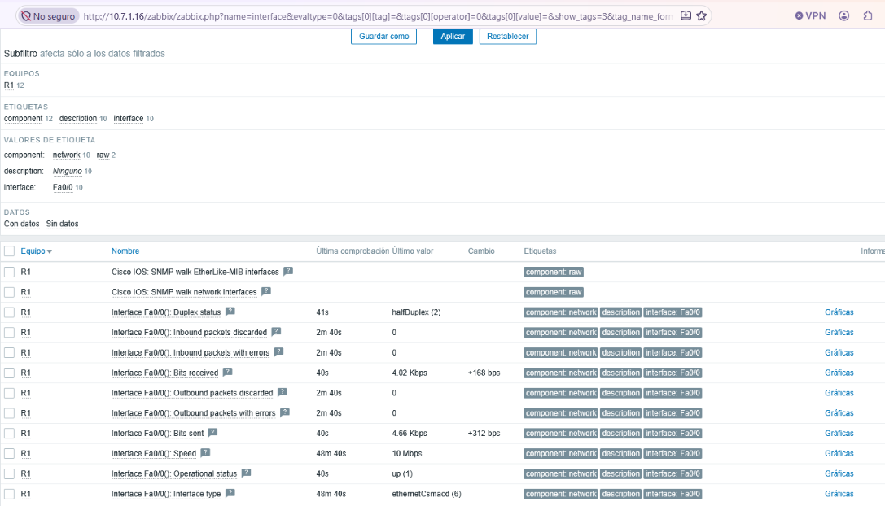<br><sub>Fa0/0: <i>up (1)</i> · 10 Mbps · recibe 4.02 Kbps y envía 4.66 Kbps.</sub></td>
<td align="center" valign="top" width="33%"><b>Interfaces de SW-1</b><br>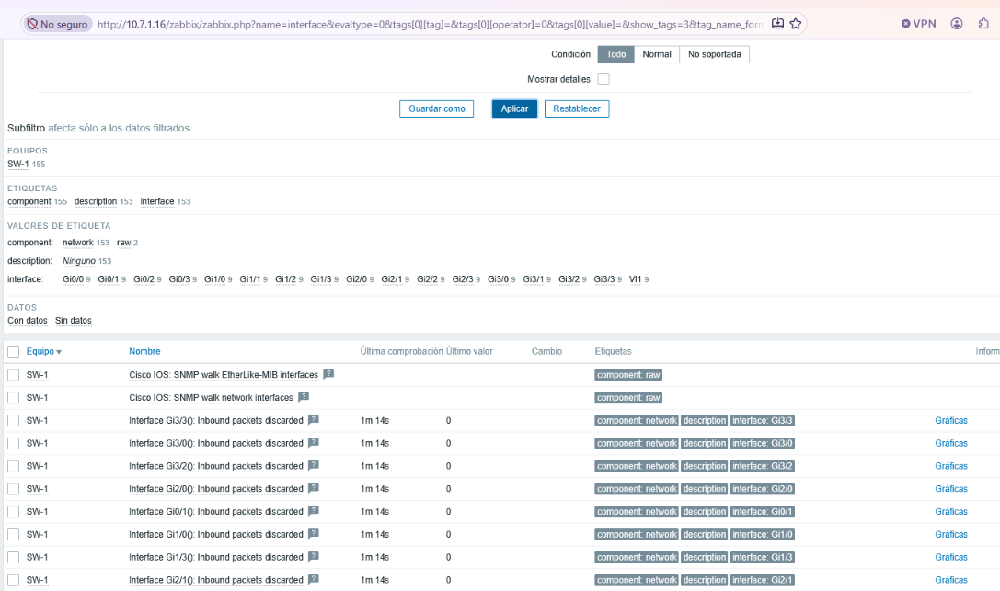<br><sub>Descubre Gi0/0 a Gi3/3 y Vl1.</sub></td>
<td align="center" valign="top" width="33%"><b>Interfaces de SW-2</b><br>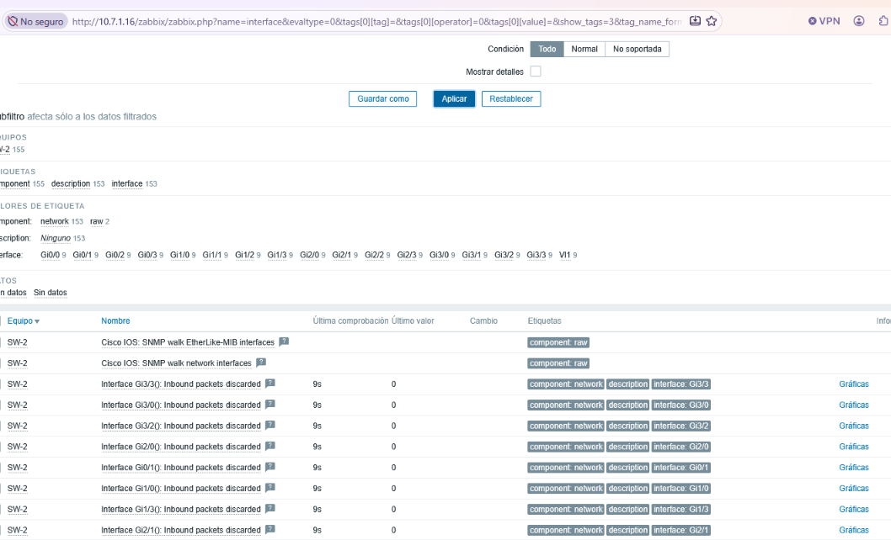<br><sub>Mismo conjunto de interfaces que SW-1.</sub></td>
</tr>
</table>

**Tráfico recibido (`Bits received`) en los puertos con cable:**

<table>
<tr>
<td align="center" valign="top" width="50%"><b>SW-1</b><br>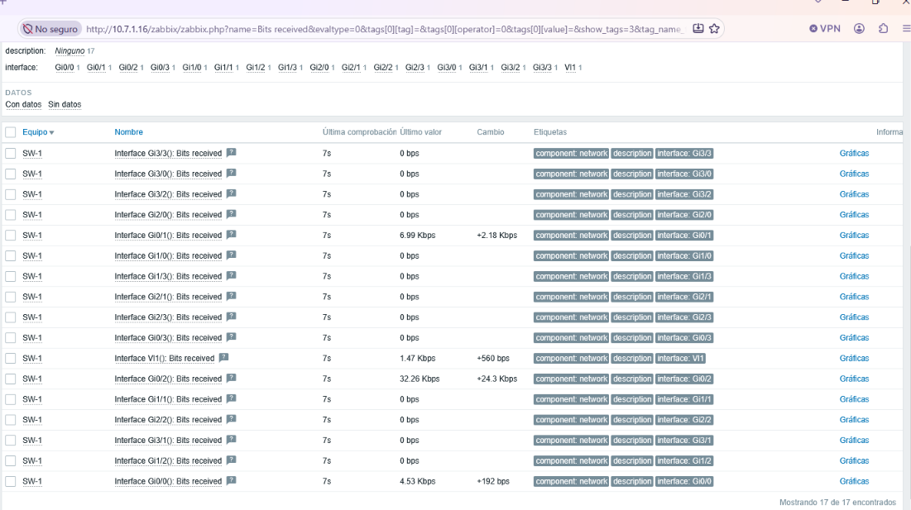<br><sub>Gi0/0 (R1) 4.53 Kbps · Gi0/1 (SW2) 6.99 Kbps · Gi0/2 (servidor) 32.26 Kbps.</sub></td>
<td align="center" valign="top" width="50%"><b>SW-2</b><br>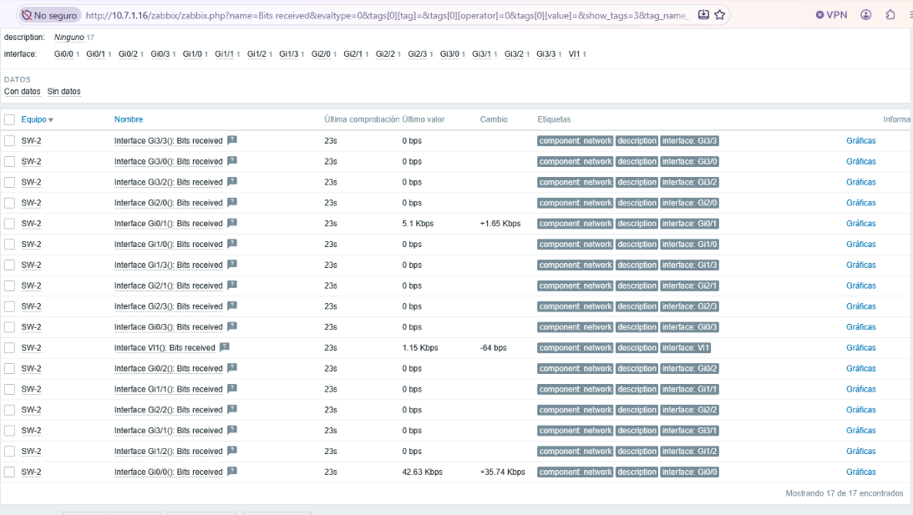<br><sub>Gi0/0 (SW1) 42.63 Kbps · Gi0/1 (PC) 5.1 Kbps. Los demás puertos marcan 0 bps.</sub></td>
</tr>
</table>

---

## 📋 Resultado frente a los requisitos

### Router y switches

| Requisito | Evidencia | Estado |
|---|---|:-:|
| Direccionamiento IP | `show ip interface brief` de R1, SW1 y SW2; pings; running-configs | ✅ |
| Servidor DHCP para la LAN | Pool `LAN`, `show ip dhcp binding`, running-config de R1 | ✅ |
| Comunidad SNMP de solo lectura | `snmpget` correcto, `snmpset` con `noAccess`, running-configs | ✅ |

### Servidor Zabbix

| Requisito | Evidencia | Estado |
|---|---|:-:|
| Cliente DHCP | `ip -4 addr`, `networkctl`, registro de `systemd-networkd` y binding en R1 | ✅ |
| Verificar datos SNMP del router y los switches | Lista de equipos con SNMP verde y *Datos más recientes* | ✅ |

### Repositorio

| Requisito | Estado |
|---|:-:|
| Documentación profesional en el repositorio | ✅ |
| 🎬 Video demostrativo al principio del repositorio | ✅ |
| Imágenes en la documentación | ✅ |
| Diagramas en la documentación | ✅ |
| Propósito del laboratorio indicado | ✅ |
| Todo script utilizado en el repositorio | ✅ |
| Running-configs en el repositorio | ✅ |

---

## 💻 Scripts

| Script | Función |
|---|---|
| [`01_instalar_zabbix.sh`](scripts/01_instalar_zabbix.sh) | Agrega el repositorio de Zabbix 7.0 e instala los paquetes |
| [`02_configurar_bd_zabbix.sh`](scripts/02_configurar_bd_zabbix.sh) | Crea la base, importa el esquema, fija `DBPassword` y arranca los servicios |
| [`03_configurar_cliente_dhcp.sh`](scripts/03_configurar_cliente_dhcp.sh) | Deja `ens33` como cliente DHCP con netplan |
| [`04_verificar_snmp.sh`](scripts/04_verificar_snmp.sh) | Prueba `snmpget` (debe funcionar), `snmpset` (debe fallar) y la comunidad incorrecta |
| [`05_evidencias_cliente_dhcp.sh`](scripts/05_evidencias_cliente_dhcp.sh) | Recolecta la evidencia del cliente DHCP |
| [`cisco/r1-config.txt`](scripts/cisco/r1-config.txt) | Comandos de R1: IP, DHCP y SNMP |
| [`cisco/sw1-config.txt`](scripts/cisco/sw1-config.txt) · [`cisco/sw2-config.txt`](scripts/cisco/sw2-config.txt) | Comandos de los switches |
| [`cisco/verificacion.txt`](scripts/cisco/verificacion.txt) | Comandos `show` usados para las evidencias |

> Los archivos de `scripts/cisco/` están construidos a partir de los running-configs. Las contraseñas se dejan como `<…>`; en los `.sh` se piden al ejecutar.

---

## 📂 Running-configs

| Equipo | Archivo |
|---|---|
| R1 | [`running-configs/R1-running-config.txt`](running-configs/R1-running-config.txt) |
| SW1 | [`running-configs/SW1-running-config.txt`](running-configs/SW1-running-config.txt) |
| SW2 | [`running-configs/SW2-running-config.txt`](running-configs/SW2-running-config.txt) |
| Ubuntu Server | [`running-configs/ubuntu-server/`](running-configs/ubuntu-server) · netplan y parámetros de `zabbix_server.conf` |

Contienen la comunidad SNMP de laboratorio. Las claves de acceso se publican ocultas.

---

## 🔧 Problemas encontrados

Incidentes del laboratorio, con su evidencia, en [`docs/04-troubleshooting.md`](docs/04-troubleshooting.md):

| Problema | Causa | Solución |
|---|---|---|
| Equipos en Zabbix con SNMP en rojo (`timed out`) | La macro `{$SNMP_COMMUNITY}` tenía un guion (`ZBX-RO`) y la comunidad real lleva guion bajo (`ZBX_RO`) | Corregir el valor de la macro |
| El servidor no podía descargar paquetes | La LAN no tiene salida a internet | Segundo adaptador con internet solo durante la instalación |
| La IP del servidor cambia | Es un cliente DHCP | Esperado; se documenta el historial |
| `System name has changed` en el dashboard | Los equipos tienen `ip domain-name red.local` | Esperado; el nombre SNMP incluye el dominio |

---

## 📁 Estructura del repositorio

```text
.
├── README.md
├── video/                     
├── docs/
│   ├── assets/                 # banner, miniatura del video y diagrama de topología
│   ├── 01-proposito-y-objetivos.md
│   ├── 02-plan-de-direccionamiento.md
│   ├── 03-procedimiento-zabbix.md
│   ├── 04-troubleshooting.md
│   └── 05-conceptos-snmp.md
├── diagrams/                   # fuentes Mermaid (.mmd)
├── screenshots/
│   ├── 01-topologia/
│   ├── 02-direccionamiento-ip/
│   ├── 03-servidor-dhcp/
│   ├── 04-snmp-solo-lectura/
│   ├── 05-zabbix-instalacion/
│   ├── 06-zabbix-cliente-dhcp/
│   ├── 07-zabbix-agregar-equipos/
│   ├── 08-zabbix-verificacion-snmp/
│   └── 09-troubleshooting/
├── scripts/
│   ├── cisco/
│   └── *.sh
└── running-configs/
    └── ubuntu-server/
```

---

<div align="center">

**Laboratorio de Redes: DHCP, SNMP y Zabbix** · Lisbeth Gómez · Matrícula 2025-0701

<sub>Valores de comunidad SNMP y contraseñas: solo para laboratorio. No reutilizar en producción.</sub>

</div>
