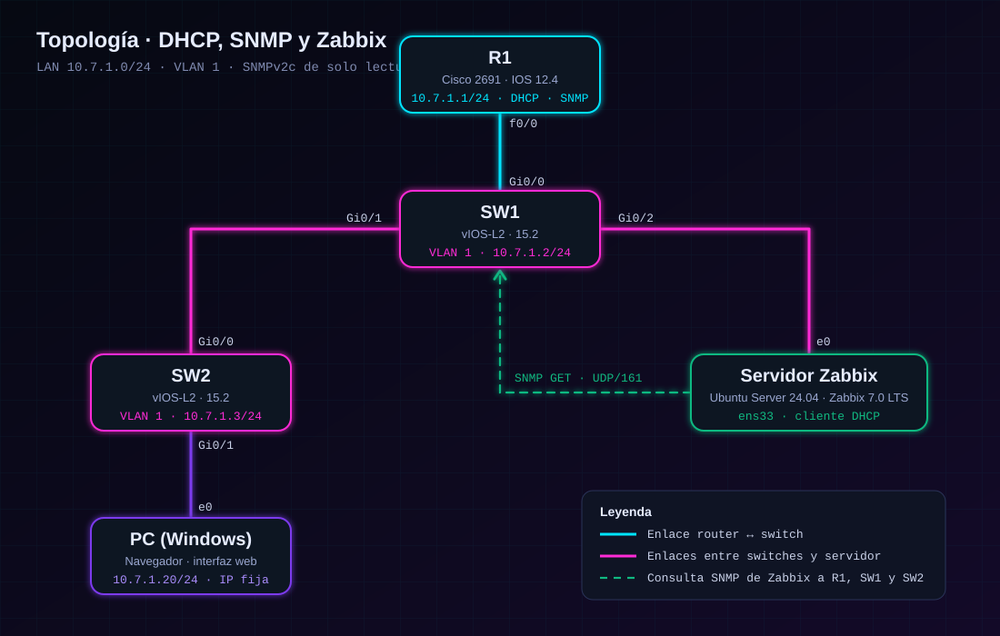

# 🧮 02 · Plan de direccionamiento

[← Anterior: Propósito](01-proposito-y-objetivos.md) · [Volver al README](../README.md) · [Siguiente: Procedimiento →](03-procedimiento-zabbix.md)

---

## Criterio de diseño

La red se construye a partir de la matrícula **2025-0701**: el segundo y el tercer octeto son los dígitos **7** y **1** de `0701`.

| Elemento | Valor |
|---|---|
| Red | `10.7.1.0/24` |
| Máscara | `255.255.255.0` |
| Gateway | `10.7.1.1` (R1) |
| Direcciones de equipos de red | `10.7.1.1` a `10.7.1.10` (reservadas, excluidas del DHCP) |
| Rango asignable por DHCP | `10.7.1.11` a `10.7.1.254` |

---

## Direcciones por equipo

| Equipo | Interfaz | Dirección | Asignación | Función |
|---|---|---|:-:|---|
| **R1** | FastEthernet0/0 | `10.7.1.1/24` | 🔵 Estática | Gateway · servidor DHCP · agente SNMP |
| **SW1** | Vlan1 | `10.7.1.2/24` | 🔵 Estática | Switch · agente SNMP · gateway `10.7.1.1` |
| **SW2** | Vlan1 | `10.7.1.3/24` | 🔵 Estática | Switch · agente SNMP · gateway `10.7.1.1` |
| **Servidor Zabbix** | ens33 | `10.7.1.11` en adelante | 🟣 DHCP | Ubuntu Server · Zabbix 7.0 LTS |
| **PC de gestión** | Ethernet0 | `10.7.1.20/24` | 🔵 Estática | Navegador para la interfaz web |

> La dirección del servidor Zabbix la entrega R1. En las capturas aparece con `10.7.1.16` y con `10.7.1.11`.

---

## Interconexiones

| Origen | Puerto | Destino | Puerto |
|---|:-:|---|:-:|
| R1 | `f0/0` | SW1 | `Gi0/0` |
| SW1 | `Gi0/1` | SW2 | `Gi0/0` |
| SW1 | `Gi0/2` | Servidor Zabbix | `e0` |
| SW2 | `Gi0/1` | PC de gestión | `e0` |

---

## Servidor DHCP (R1)

| Parámetro | Valor |
|---|---|
| Nombre del pool | `LAN` |
| Red | `10.7.1.0 255.255.255.0` |
| Direcciones excluidas | `10.7.1.1` – `10.7.1.10` |
| Default router | `10.7.1.1` |
| Servidor DNS | `8.8.8.8` |

```
ip dhcp excluded-address 10.7.1.1 10.7.1.10
!
ip dhcp pool LAN
 network 10.7.1.0 255.255.255.0
 default-router 10.7.1.1
 dns-server 8.8.8.8
```

---

## SNMP

| Parámetro | Valor |
|---|---|
| Versión | SNMPv2c |
| Comunidad | `ZBX_RO` |
| Permiso | `RO` (solo lectura) |
| Puerto | UDP/161 |
| `sysLocation` | `Laboratorio` |

```
snmp-server community ZBX_RO RO
snmp-server location Laboratorio
```

---

## Diagrama

<div align="center">

</div>

---

[← Anterior: Propósito](01-proposito-y-objetivos.md) · [Volver al README](../README.md) · [Siguiente: Procedimiento →](03-procedimiento-zabbix.md)
