# 🧩 03 · Procedimiento

[← Anterior: Direccionamiento](02-plan-de-direccionamiento.md) · [Volver al README](../README.md) · 

Orden en que se ejecutó el laboratorio. Los comandos están también en [`scripts/`](../scripts).

| Fase | Contenido |
|:-:|---|
| [1](#fase-1--router-r1) | Router R1: IP, DHCP y SNMP |
| [2](#fase-2--switches-sw1-y-sw2) | Switches SW1 y SW2: IP de gestión y SNMP |
| [3](#fase-3--red-del-servidor-ubuntu) | Red del servidor Ubuntu |
| [4](#fase-4--instalación-de-zabbix) | Instalación de Zabbix 7.0 LTS |
| [5](#fase-5--asistente-web) | Asistente web |
| [6](#fase-6--alta-de-los-equipos-en-zabbix) | Alta de R1, SW1 y SW2 en Zabbix |
| [7](#fase-7--verificación) | Verificación |

---

## Fase 1 — Router R1

Script: [`scripts/cisco/r1-config.txt`](../scripts/cisco/r1-config.txt)

**Interfaz LAN**

```
enable
configure terminal
hostname R1

interface FastEthernet0/0
 ip address 10.7.1.1 255.255.255.0
 no shutdown
exit
```

**Servidor DHCP** — se reservan las primeras diez direcciones para los equipos de red.

```
ip dhcp excluded-address 10.7.1.1 10.7.1.10

ip dhcp pool LAN
 network 10.7.1.0 255.255.255.0
 default-router 10.7.1.1
 dns-server 8.8.8.8
exit
```

**SNMP de solo lectura**

```
snmp-server community ZBX_RO RO
snmp-server location Laboratorio
end
write memory
```

**Verificación**

```
show ip interface brief
show running-config | section dhcp
show running-config | include snmp
```

<table>
<tr>
<td align="center" valign="top" width="33%"><b>Interfaces</b><br>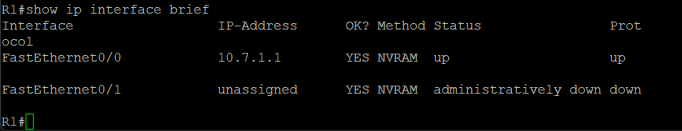</td>
<td align="center" valign="top" width="33%"><b>Pool DHCP</b><br>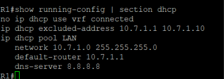</td>
<td align="center" valign="top" width="33%"><b>SNMP</b><br>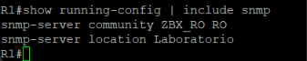</td>
</tr>
</table>

---

## Fase 2 — Switches SW1 y SW2

Scripts: [`sw1-config.txt`](../scripts/cisco/sw1-config.txt) · [`sw2-config.txt`](../scripts/cisco/sw2-config.txt)

Los switches son de capa 2: la IP se configura en la interfaz de gestión **VLAN 1** y el gateway con `ip default-gateway`.

**SW1**

```
enable
configure terminal
hostname SW1

interface vlan 1
 ip address 10.7.1.2 255.255.255.0
 no shutdown
exit
ip default-gateway 10.7.1.1

snmp-server community ZBX_RO RO
snmp-server location Laboratorio
end
write memory
```

**SW2** — igual, con `hostname SW2` y la dirección `10.7.1.3`.

**Verificación**

```
show ip interface brief
show running-config | include snmp
```

<table>
<tr>
<td align="center" valign="top" width="50%"><b>SW1 · interfaces</b><br>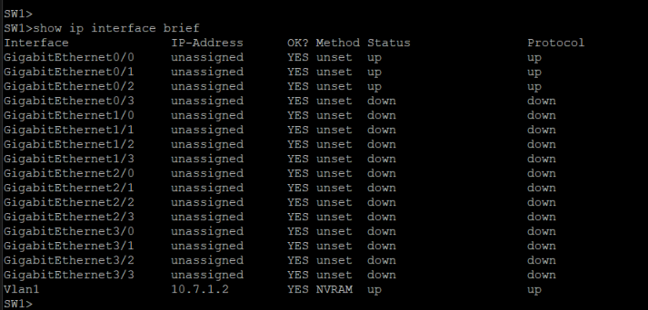</td>
<td align="center" valign="top" width="50%"><b>SW2 · interfaces</b><br>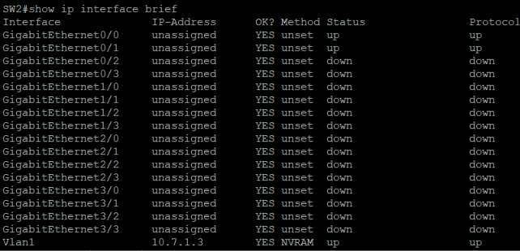</td>
</tr>
<tr>
<td align="center" valign="top"><b>SW1 · SNMP</b><br>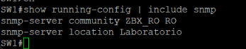</td>
<td align="center" valign="top"><b>SW2 · SNMP</b><br>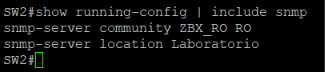</td>
</tr>
</table>

**Conectividad entre los equipos de red**

<table>
<tr>
<td align="center" valign="top" width="50%"><b>Pings desde R1</b><br>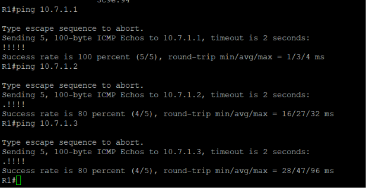</td>
<td align="center" valign="top" width="50%"><b>Pings desde el servidor</b><br>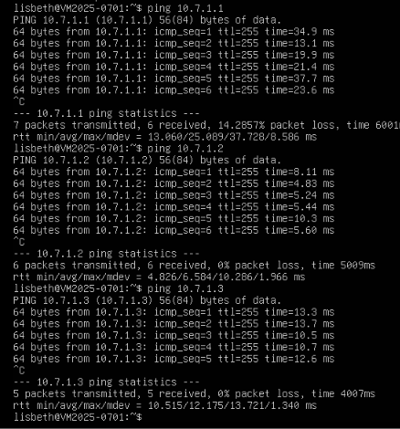</td>
</tr>
</table>

---

## Fase 3 — Red del servidor Ubuntu

Scripts: [`03_configurar_cliente_dhcp.sh`](../scripts/03_configurar_cliente_dhcp.sh) · [`05_evidencias_cliente_dhcp.sh`](../scripts/05_evidencias_cliente_dhcp.sh)

El servidor se conecta a **SW1 Gi0/2** y toma su dirección de R1 por DHCP.

**Durante la instalación** el servidor necesita descargar paquetes. Como la LAN no tiene salida a internet, se le agregó un segundo adaptador con acceso a internet, también por DHCP, usado solo en esa etapa:

```yaml
network:
  version: 2
  ethernets:
    ens33:            # LAN del laboratorio (R1 · DHCP)
      dhcp4: true
      dhcp4-overrides:
        use-routes: false
    ens37:            # salida a internet (solo durante la instalación)
      dhcp4: true
```

**Configuración final** — con Zabbix instalado se retira el segundo adaptador y queda solo la LAN:

```yaml
network:
  version: 2
  ethernets:
    ens33:
      dhcp4: true
```

```bash
sudo netplan apply
ip -4 addr show ens33
```

**Verificación en R1**

```
show ip dhcp binding
show ip dhcp conflict
show ip dhcp pool
```

<table>
<tr>
<td align="center" valign="top" width="50%"><b>IP dinámica en el servidor</b><br>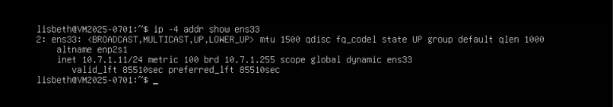</td>
<td align="center" valign="top" width="50%"><b>Concesión, conflictos y pool en R1</b><br>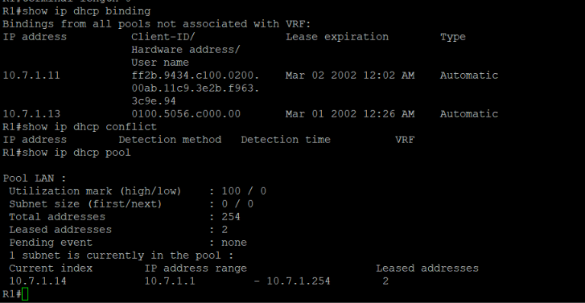</td>
</tr>
</table>

La **PC de gestión** usa una dirección fija, `10.7.1.20/24`, con gateway `10.7.1.1`.

---

## Fase 4 — Instalación de Zabbix

Scripts: [`01_instalar_zabbix.sh`](../scripts/01_instalar_zabbix.sh) · [`02_configurar_bd_zabbix.sh`](../scripts/02_configurar_bd_zabbix.sh)

**1 · Paquetes** (`01_instalar_zabbix.sh`)

1. MySQL Server.
2. Repositorio oficial de Zabbix 7.0 LTS para Ubuntu 24.04.
3. `zabbix-server-mysql`, `zabbix-frontend-php`, `zabbix-apache-conf`, `zabbix-sql-scripts`, `zabbix-agent2` y `snmp`.

```bash
sudo bash scripts/01_instalar_zabbix.sh
```

**2 · Base de datos y servicios** (`02_configurar_bd_zabbix.sh`)

1. Crea la base `zabbix` (`utf8mb4` · `utf8mb4_bin`) y el usuario `zabbix`.
2. Importa el esquema inicial.
3. Fija `DBPassword` en `/etc/zabbix/zabbix_server.conf`.
4. Habilita e inicia `zabbix-server`, `zabbix-agent2` y `apache2`.

```bash
sudo bash scripts/02_configurar_bd_zabbix.sh
```

El script pide la contraseña de la base de datos al ejecutarse.

<div align="center">
<b>Servicio activo</b><br>
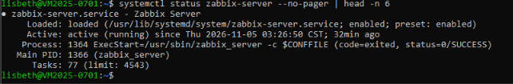
</div>

---

## Fase 5 — Asistente web

Desde la PC de gestión se abre `http://IP_DEL_SERVIDOR/zabbix` y se completa el asistente.

<table>
<tr>
<td align="center" valign="top" width="33%"><b>1 · Bienvenida</b><br>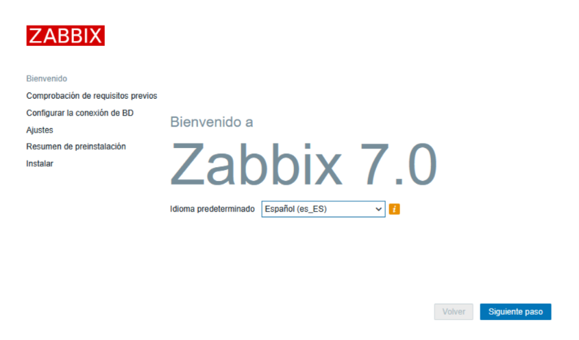</td>
<td align="center" valign="top" width="33%"><b>2 · Conexión de BD</b><br>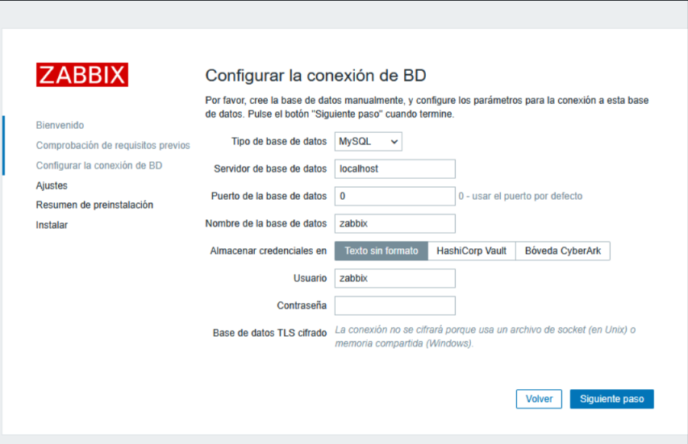</td>
<td align="center" valign="top" width="33%"><b>3 · Ajustes</b><br>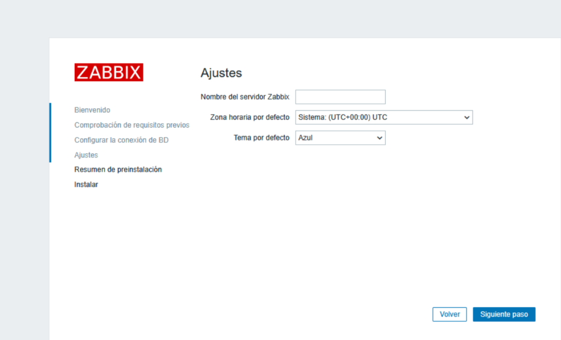</td>
</tr>
</table>

| Dato del asistente | Valor |
|---|---|
| Idioma | Español |
| Base de datos | MySQL · servidor `localhost` · base `zabbix` |
| Usuario | `zabbix` (con la contraseña definida en la fase 4) |
| Zona horaria | La de la región (por ejemplo `America/Santo_Domingo`) |

Al terminar, el dashboard confirma que el servidor está en ejecución:

<div align="center">
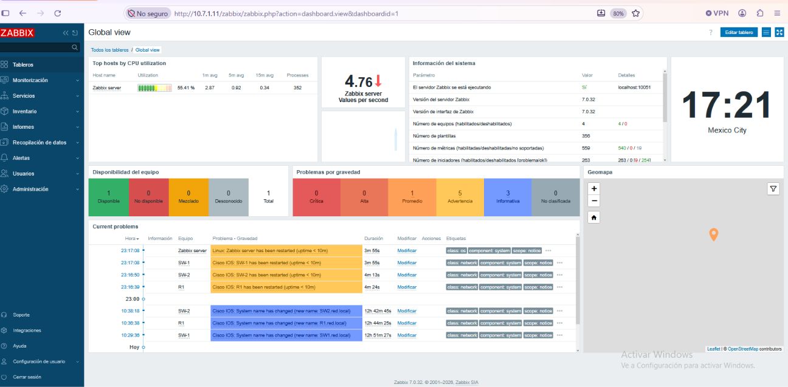
</div>

---

## Fase 6 — Alta de los equipos en Zabbix

**Recopilación de datos → Equipos → Crear equipo**

| Campo | R1 | SW1 | SW2 |
|---|---|---|---|
| Nombre del equipo | `R1` | `SW-1` | `SW-2` |
| Plantilla | Cisco IOS by SNMP | Cisco IOS by SNMP | Cisco IOS by SNMP |
| Grupo de equipos | Network devices | Network devices | Network devices |
| Interfaz | SNMP · `10.7.1.1` · `161` | SNMP · `10.7.1.2` · `161` | SNMP · `10.7.1.3` · `161` |
| Versión SNMP | SNMPv2 | SNMPv2 | SNMPv2 |
| Comunidad SNMP | `{$SNMP_COMMUNITY}` | `{$SNMP_COMMUNITY}` | `{$SNMP_COMMUNITY}` |

En la pestaña **Macros** de cada equipo:

| Macro | Valor |
|---|---|
| `{$SNMP_COMMUNITY}` | `ZBX_RO` |

> El valor de la macro debe coincidir **exactamente** con la comunidad configurada en el equipo (mayúsculas y guion bajo). Si no coincide, el agente SNMP no responde y Zabbix marca el equipo como no disponible. Ver [troubleshooting](04-troubleshooting.md).

<table>
<tr>
<td align="center" valign="top" width="50%"><b>Formulario de R1</b><br>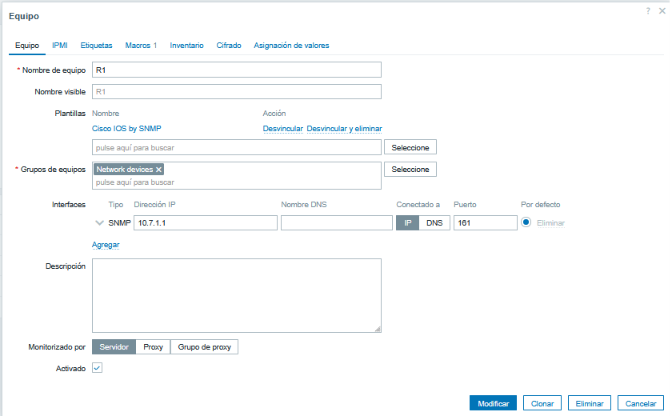</td>
<td align="center" valign="top" width="50%"><b>Macros</b><br>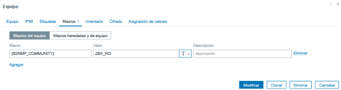</td>
</tr>
</table>

<div align="center">
<b>Equipos con SNMP disponible</b><br>
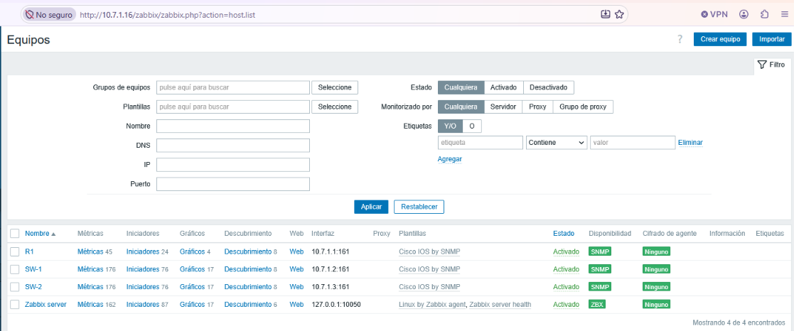
</div>

---

## Fase 7 — Verificación

**Desde el servidor** — script [`04_verificar_snmp.sh`](../scripts/04_verificar_snmp.sh) o comando por comando:

```bash
snmpget -v2c -c ZBX_RO 10.7.1.1 1.3.6.1.2.1.1.5.0
snmpset -v2c -c ZBX_RO 10.7.1.1 1.3.6.1.2.1.1.6.0 s 'prueba'
snmpget -v2c -c otra  10.7.1.1 1.3.6.1.2.1.1.5.0
```

Las herramientas `snmpget` y `snmpset` pertenecen al paquete `snmp` de Linux, por lo que estas pruebas se ejecutan en el **servidor Ubuntu** (o por SSH desde la PC).

**Desde Zabbix** — Monitorización → Datos más recientes, filtrando por equipo.

Resultados y capturas completas en el [README](../README.md#-comunidad-snmp-de-solo-lectura) y en la sección [Verificación de datos SNMP en Zabbix](../README.md#-verificación-de-datos-snmp-en-zabbix).

---

[← Anterior: Direccionamiento](02-plan-de-direccionamiento.md) · [Volver al README](../README.md) 
