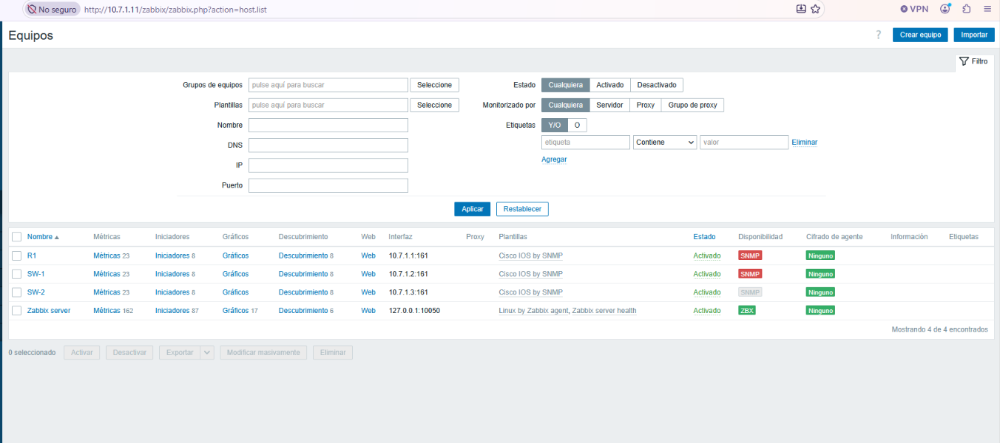
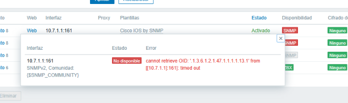
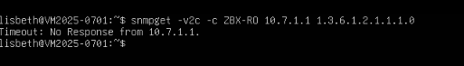
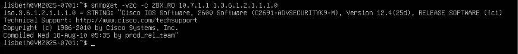
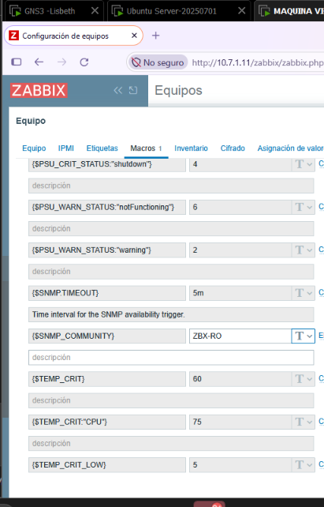
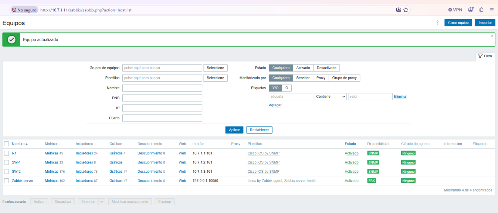
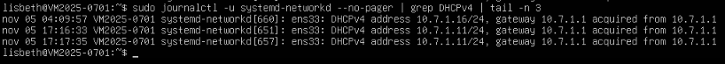
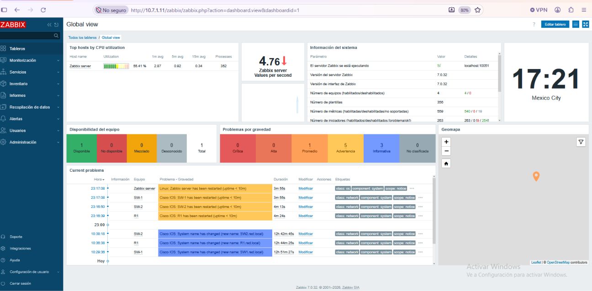

# 🔧 04 · Problemas encontrados

[← Anterior: Procedimiento](03-procedimiento-zabbix.md) · [Volver al README](../README.md) · [Siguiente: Conceptos SNMP →](05-conceptos-snmp.md)

Incidentes reales del laboratorio, con su causa y su solución. Solo se incluyen los que afectan al resultado o ayudan a interpretar las capturas.

| # | Problema | Causa | Solución |
|:-:|---|---|---|
| [1](#1--equipos-con-snmp-en-rojo-en-zabbix) | Equipos con SNMP en rojo en Zabbix (`timed out`) | La macro `{$SNMP_COMMUNITY}` tenía un guion (`ZBX-RO`) y la comunidad real lleva guion bajo (`ZBX_RO`) | Corregir el valor de la macro |
| [2](#2--el-servidor-no-tenía-salida-a-internet) | El servidor no podía descargar paquetes | La LAN no tiene salida a internet | Segundo adaptador con internet solo durante la instalación |
| [3](#3--la-ip-del-servidor-cambia) | La IP del servidor cambió (`.16` → `.11`) | Es un cliente DHCP | Esperado; se documenta el historial |
| [4](#4--aviso-system-name-has-changed-en-el-dashboard) | `System name has changed` en el dashboard | Los equipos tienen `ip domain-name red.local` | Esperado |
| [5](#5--elementos-de-hardware-no-soportados) | Elementos de hardware *no soportados* | Equipos virtuales | Esperado |

---

## 1 · Equipos con SNMP en rojo en Zabbix

**Síntoma.** Tras agregar R1, SW-1 y SW-2, el indicador **SNMP** de la lista de equipos aparecía en rojo (SW-2 aún sin sondear).

<table>
<tr>
<td align="center" valign="top" width="50%"><b>Lista de equipos</b><br></td>
<td align="center" valign="top" width="50%"><b>Mensaje de error de Zabbix</b><br></td>
</tr>
</table>

El mensaje indica que Zabbix **no recibió respuesta** (`timed out`) del agente SNMP de `10.7.1.1`.

**Diagnóstico.** Se probó la misma consulta desde el servidor con `snmpget`:

<table>
<tr>
<td align="center" valign="top" width="50%"><b>Comunidad <code>ZBX-RO</code> (con guion)</b><br><br><sub><code>Timeout: No Response</code></sub></td>
<td align="center" valign="top" width="50%"><b>Comunidad <code>ZBX_RO</code> (con guion bajo)</b><br><br><sub>R1 responde con su descripción.</sub></td>
</tr>
</table>

La comunidad configurada en los equipos es `ZBX_RO`. Al revisar la pestaña **Macros** del equipo en Zabbix, el valor de `{$SNMP_COMMUNITY}` era `ZBX-RO`:

[](../screenshots/09-troubleshooting/04-macro-comunidad-incorrecta.png)

**Solución.** Corregir la macro a `ZBX_RO` en R1, SW-1 y SW-2. Pocos minutos después los tres equipos quedaron con SNMP en verde.

[](../screenshots/09-troubleshooting/06-equipos-snmp-verde-tras-correccion.png)

> **Lección.** En SNMPv2c el agente **no contesta** a una comunidad que no conoce: no hay mensaje de "acceso denegado", solo un *timeout*. Si Zabbix marca un equipo en rojo, lo primero es comparar la comunidad de la macro con la del equipo y probarla con `snmpget`.

---

## 2 · El servidor no tenía salida a internet

**Síntoma.** El servidor, conectado solo a la LAN, no podía descargar paquetes de Zabbix.

**Causa.** R1 es el gateway de la LAN pero no tiene salida a internet.

**Solución.** Se agregó un segundo adaptador con acceso a internet **solo durante la instalación**, y en la LAN se desactivó la ruta por defecto para que el tráfico saliera por el adaptador con internet:

```yaml
network:
  version: 2
  ethernets:
    ens33:
      dhcp4: true
      dhcp4-overrides:
        use-routes: false
    ens37:
      dhcp4: true
```

Terminada la instalación se retiró ese adaptador y el netplan quedó solo con `ens33` (ver [procedimiento](03-procedimiento-zabbix.md#fase-3--red-del-servidor-ubuntu)).

---

## 3 · La IP del servidor cambia

**Observación.** El servidor tomó `10.7.1.16` y, después de reiniciar el laboratorio, `10.7.1.11`.

[](../screenshots/06-zabbix-cliente-dhcp/ens33-historial-dhcpv4.png)

**Causa.** Es un cliente DHCP: R1 entrega la dirección libre que tiene en ese momento, y las concesiones de un router de laboratorio se pierden al reiniciarlo. Por eso algunas capturas de Zabbix muestran `10.7.1.16` en la barra de direcciones y otras `10.7.1.11`.

**Impacto.** Ninguno en el monitoreo: Zabbix consulta a R1, SW1 y SW2 por sus direcciones **fijas**; solo cambia la dirección de la interfaz web.

**Si se necesitara una dirección estable** (opción no usada en este laboratorio): reservarla en R1 con un pool por cliente (`host` + `client-identifier`) y que el servidor use `dhcp-identifier: mac` en netplan.

---

## 4 · Aviso "System name has changed" en el dashboard

El dashboard muestra avisos del tipo *"Cisco IOS: System name has changed (new name: R1.red.local)"* y de reinicio (*uptime < 10m*).

[](../screenshots/05-zabbix-instalacion/dashboard-servidor-ejecutando.png)

- **Cambio de nombre.** Los equipos tienen `ip domain-name red.local`, y el nombre que reportan por SNMP incluye el dominio: `R1.red.local`, `SW1.red.local` y `SW2.red.local`. Por eso `snmpget` mostró `R1`, `SW1` y `SW2` en las primeras pruebas y Zabbix muestra el nombre con dominio en las capturas posteriores.
- **Reinicios.** Corresponden a que el laboratorio se reinició entre sesiones.

Son disparadores normales de la plantilla de Zabbix y confirman que el monitoreo detecta cambios.

---

## 5 · Elementos de hardware no soportados

En SW-1 y SW-2 los elementos *Hardware model name*, *Hardware serial number* y *Operating system* aparecen como **no soportados** (icono rojo).

Los switches son **virtuales** (vIOS-L2) y no publican esa información por SNMP. No afecta a los datos que importan para el laboratorio: nombre, ubicación, descripción, disponibilidad, interfaces y tráfico.

---

[← Anterior: Procedimiento](03-procedimiento-zabbix.md) · [Volver al README](../README.md) · [Siguiente: Conceptos SNMP →](05-conceptos-snmp.md)
