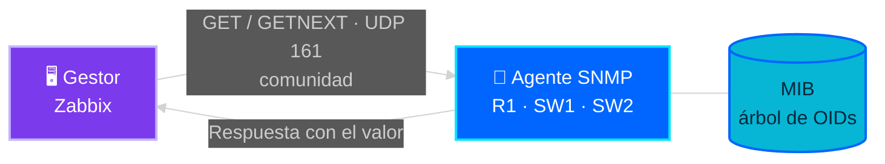

# 📚 05 · Conceptos SNMP

[← Anterior: Troubleshooting](04-troubleshooting.md) · [Volver al README](../README.md)

---

## Qué es SNMP

**SNMP** (*Simple Network Management Protocol*) permite consultar y, si se autoriza, modificar información de gestión de equipos de red. Funciona con dos roles:

| Rol | En el laboratorio | Función |
|---|---|---|
| **Gestor** (*manager*) | Servidor Zabbix | Pregunta a los equipos |
| **Agente** (*agent*) | R1, SW1 y SW2 | Responde con sus datos |

Las consultas viajan por **UDP/161**. Cada dato se identifica con un **OID** (identificador de objeto) dentro de una **MIB**.

---

## Versiones

| Versión | Autenticación | Cifrado | Uso |
|:-:|---|:-:|---|
| v1 | Comunidad | No | Obsoleta |
| **v2c** | **Comunidad** | **No** | **Usada en este laboratorio** |
| v3 | Usuario, clave y privacidad | Sí | Recomendada en producción |

## Comunidad `RO` y `RW`

La **comunidad** funciona como una contraseña compartida y define el permiso:

| Permiso | Palabra clave | Efecto |
|---|:-:|---|
| Solo lectura | `RO` | Permite `GET`; las escrituras se rechazan con `noAccess` |
| Lectura y escritura | `RW` | Permite también `SET` |

En el laboratorio solo existe la comunidad `ZBX_RO`, con permiso `RO`.

---

## OIDs utilizados en las pruebas

| OID | Objeto | Uso |
|---|---|---|
| `1.3.6.1.2.1.1.1.0` | `sysDescr` | Descripción del equipo |
| `1.3.6.1.2.1.1.5.0` | `sysName` | Nombre del equipo (prueba de **lectura**) |
| `1.3.6.1.2.1.1.6.0` | `sysLocation` | Ubicación (prueba de **escritura**) |

## Comandos `net-snmp` usados

| Comando | Sirve para |
|---|---|
| `snmpget -v2c -c ZBX_RO <ip> <oid>` | Leer un valor |
| `snmpset -v2c -c ZBX_RO <ip> <oid> s '<texto>'` | Intentar escribir un texto (`s` = *string*) |

---

## Cómo lo usa Zabbix

| Elemento | Detalle |
|---|---|
| Plantilla | **Cisco IOS by SNMP** |
| Interfaz | SNMP · versión SNMPv2 · puerto 161 |
| Comunidad | Macro `{$SNMP_COMMUNITY}` = `ZBX_RO` |
| Datos que recoge | Descripción, nombre y ubicación del sistema, tiempo de actividad, estado e interfaces, tráfico (`Bits received` y `Bits sent`), ICMP |
| Elementos maestros | *Cisco IOS: SNMP walk …* recolectan en bloque para los demás elementos |

---

## Seguridad

- En **v2c** la comunidad viaja en **texto claro**: cualquiera que capture el tráfico la ve.
- Una comunidad `RO` evita cambios, pero igual **expone** información de la red.
- Un agente SNMP **no responde** a una comunidad desconocida, por lo que el cliente solo ve un *timeout*.

**Recomendaciones para producción**

1. Usar **SNMPv3** con autenticación y cifrado.
2. Limitar con una **ACL** quién puede consultar el agente.
3. Evitar comunidades predecibles como `public` y no usar `RW` salvo que sea indispensable.

---

[← Anterior: Troubleshooting](04-troubleshooting.md) · [Volver al README](../README.md)
